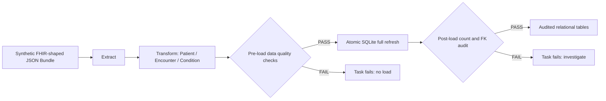

# Synthetic Clinical Data ETL with Apache Airflow

[](https://github.com/KilgoreC1024/airflow-synthetic-clinical-etl/actions/workflows/tests.yml)

> **Portfolio project.** An original, intentionally small Apache Airflow data engineering demonstration using **100% fictional healthcare records**. No employer code, patient information, protected health information (PHI), or credentials are included.

## What this demonstrates

- **Airflow TaskFlow API:** an observable, manually triggered DAG with explicit task dependencies and an extraction retry policy.
- **Healthcare modeling:** transform simplified, FHIR-shaped `Patient`, `Encounter`, and `Condition` resources into a relational SQL schema.
- **Pre-load quality gates:** validate required fields, timestamps, uniqueness, patient references, and patient/encounter consistency.
- **Reliability:** atomic SQLite full refresh, foreign-key constraints, repeatable runs, and a post-load audit.
- **Testability:** business logic is independent of Airflow, with offline unit tests on Linux and Windows, plus a GitHub Actions job that builds the Docker image and executes the full DAG with Apache Airflow on every push.

This **does not** claim to be a production FHIR integration or enterprise data warehouse. FHIR-shaped means representative of the structure of selected FHIR R4 resources, **not full FHIR specification conformance**. All records are deterministic and synthetic.

## Architecture



Airflow DAG (`dags/synthetic_clinical_etl.py`):

`extract → transform → quality_gate → load → audit`

**Model:** `patients (1) → (many) encounters (1) → (many) conditions`; condition also references the patient to allow a consistency check. Source is `data/synthetic_fhir_bundle.json`; local output is `runtime/clinical_demo.sqlite`, which is ignored by Git.

## Quickest tryout — no Airflow installation

Requirements: Python **3.10+**. The ETL and tests use only Python's standard library.

```bash
# Linux/macOS, from repository root
PYTHONPATH=src python -m clinical_etl.cli
PYTHONPATH=src python -m clinical_etl.inspect
PYTHONPATH=src python -m unittest discover -s tests -v
```

For **Windows PowerShell**:

```powershell
$env:PYTHONPATH="src"
python -m clinical_etl.cli
python -m clinical_etl.inspect
python -m unittest discover -s tests -v
```

Expected ETL output:

```json
{
  "status": "PASS",
  "row_counts": {"patients": 4, "encounters": 6, "conditions": 7},
  "checks": {"foreign_key_violations": 0, "cross_patient_conditions": 0}
}
```

Run it again. Counts remain the same: this is an **idempotent full refresh**.

The unit tests report `Ran 12 tests ... OK (skipped=3)`: the three skipped tests in `tests/test_airflow_dag.py` need Apache Airflow and run in CI (see below).

## Continuous integration

Every push runs [`.github/workflows/tests.yml`](.github/workflows/tests.yml):

- **Python ETL (Ubuntu and Windows):** compile, unit tests, and a full CLI run.
- **Airflow DAG run (Docker image):** builds this repository's `Dockerfile`, initializes the Airflow metadata database, and executes `synthetic_clinical_etl` end to end with `dag.test()`, asserting that all five tasks succeed, then prints the audited output tables.

## Run the actual Airflow DAG (Docker)

Requirements: Docker Engine/Desktop with Docker Compose and sufficient memory for a local Airflow instance (4 GB or more recommended). This is a **local development demo**, not a multi-service production stack.

```bash
docker compose up --build
```

Open **http://localhost:8080** and log in as `admin`. To retrieve the password generated by Airflow standalone (if not shown in the logs):

```bash
docker compose exec airflow cat /opt/airflow/state/standalone_admin_password.txt
```

Find `synthetic_clinical_etl` in the DAG list, enable it if necessary, and select **Trigger DAG**. The Graph view shows the five tasks and whether each quality gate passed. The DAG does **not** run on a schedule by default.

After it finishes:

```bash
docker compose exec airflow python -m clinical_etl.inspect \
  --db /opt/airflow/demo/runtime/clinical_demo.sqlite
```

Stop with `docker compose down`. To wipe the local Airflow metadata and synthetic output, use `docker compose down --volumes`.

**Alternative:** Use the [official Airflow 2.10.5 quick start](https://airflow.apache.org/docs/apache-airflow/2.10.5/start.html) with Python 3.11, set `PYTHONPATH` to the absolute `src/` directory, `AIRFLOW__CORE__DAGS_FOLDER` to the absolute `dags/` directory, and `CLINICAL_ETL_PROJECT_ROOT` to this repository's absolute path. Then run `airflow standalone`.

## Design choices and limitations

| Choice | Why | Production evolution |
| --- | --- | --- |
| Local JSON and SQLite | Easy to evaluate and test, no cloud account | API ingestion and cloud object storage/warehouse |
| Small payload passed in XCom | Keeps the demo easy to follow | Pass object-storage URIs, not datasets, through XCom |
| Full refresh in one transaction | Idempotency and easy rollback | Incremental merge with watermarks and audit tables |
| Manual DAG trigger | Nothing external to poll | Timetable tied to source delivery and SLAs |
| Validate before and after load | Surface bad data and detect broken relationships | Broader freshness, null-rate, and anomaly checks |
| Airflow standalone / SQLite executor | Simple local onboarding | Multi-service deployment, managed metadata DB, secrets manager |

The demo enforces selected relationships and required fields, but does **not** perform comprehensive clinical coding validation, patient identity resolution, authorization, or FHIR R4 validation. It must never be used with real patient information.

## What to explore next

1. In `data/synthetic_fhir_bundle.json`, change an `Encounter.subject.reference` to `Patient/pat-DOES-NOT-EXIST` and rerun. The pre-load quality gate fails **before any database replacement**.
2. Restore the original fixture and rerun. The pipeline passes again.
3. Explain how you'd replace local file ingestion with secure FHIR API pagination, move payloads to cloud object storage, use incremental loads, and add freshness and SLA monitoring.

## Repository layout

```text
.
├── dags/synthetic_clinical_etl.py    # Airflow orchestration, retries, quality gates
├── src/clinical_etl/                 # Framework-independent ETL and CLI
├── data/synthetic_fhir_bundle.json   # Fictional patient/encounter/condition data
├── tests/test_pipeline.py            # Offline quality and idempotency tests
├── tests/test_airflow_dag.py         # End-to-end DAG run (needs Airflow; runs in CI)
├── docs/INTERVIEW_NOTES.md           # Architecture and trade-off talking points
├── .github/workflows/tests.yml       # CI tests on push / pull request
├── Dockerfile                        # Official Apache Airflow base image
└── compose.yaml                      # One-command local Airflow UI
```

## Ethical portfolio note

This project was developed as a **separate demonstration** of common data engineering concepts. It does not reproduce or disclose internal employer systems, datasets, DAGs, or architectural configurations. If describing it on a résumé, call it a **portfolio proof of concept**, not production clinical data experience.

## License

MIT. Synthetic examples for learning and demonstration, not medical use.
